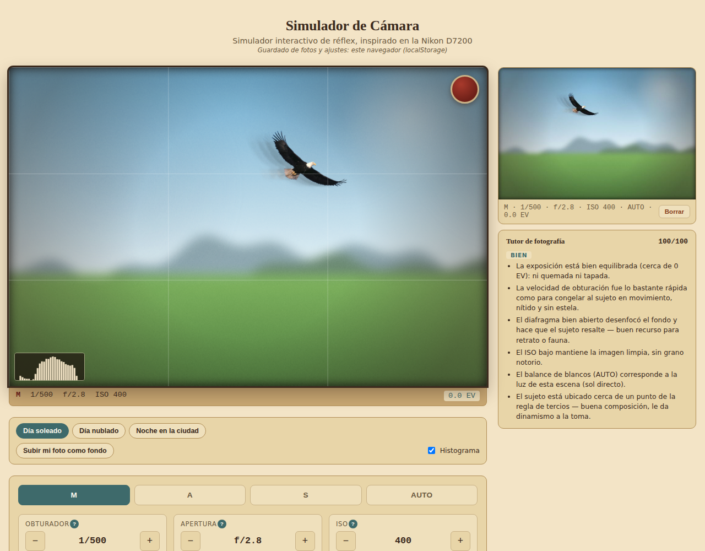
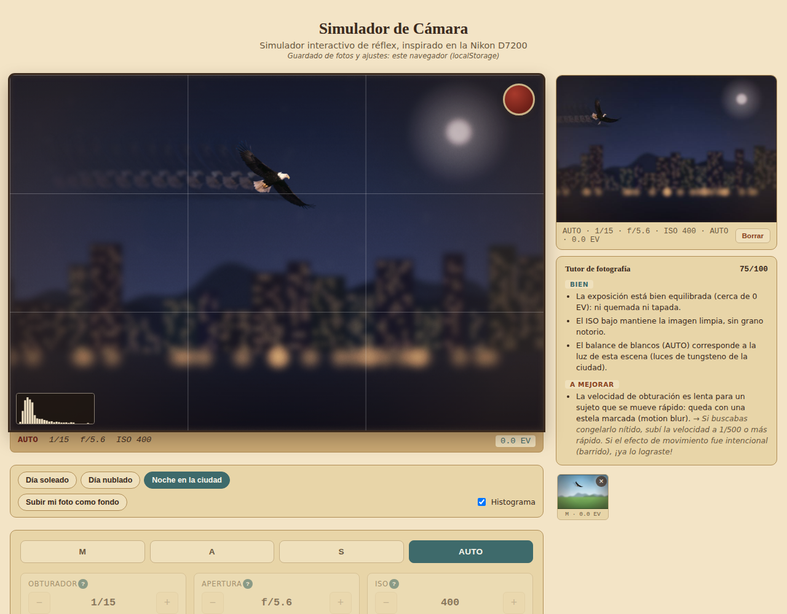
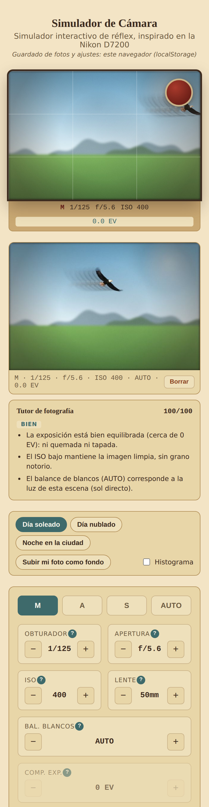

# Simulador de Cámara 📷

Simulador interactivo de una cámara réflex (inspirado en la Nikon D7200) que **te enseña fotografía mientras jugás**: movés obturador, apertura, ISO, lente, balance de blancos y compensación de exposición, sacás la foto, y un **tutor** te dice qué salió bien, qué salió mal y cómo corregirlo. Incluye escenas con luz distinta, desafíos con puntaje, histograma en vivo y progreso guardado.

**Demo:** https://camera-simulator.web.app



| Noche en la ciudad (modo AUTO) | En el celular |
| --- | --- |
|  |  |

> Las capturas usan la escena generada por código. Si agregás tus propias fotos en `src/assets/scenes/` (ver abajo) se usan en su lugar.

## Qué hace

- **Exposición real, en pasos (EV):** cada paso de obturador, apertura o ISO suma o resta exactamente 1 EV. El visor refleja la sobre/subexposición, el desenfoque de fondo (profundidad de campo), el grano por ISO y la estela de movimiento por velocidad de obturación.
- **Modos M / A / S / AUTO con fotómetro simulado:** en A, S y AUTO la cámara calcula sola el parámetro que falta y respeta la compensación de exposición, igual que una réflex.
- **Escenas con su propia luz:** día soleado, nublado y noche. Cada una define cuánta luz hay y de qué color es; el balance de blancos correcto cambia según la escena. También podés **subir tu propia foto** como fondo.
- **Tutor de fotografía en español:** analiza exposición, congelado de movimiento, profundidad de campo, ruido, balance de blancos y composición (regla de tercios) con los números reales de la toma, y devuelve _bien / a mejorar → cómo corregirlo_ con un puntaje de 0 a 100.
- **Desafíos con puntaje:** 5 consignas ("Congelá al águila", "Fondo cremoso", "Noche sin perder detalle"…) evaluadas con las mismas reglas del tutor. El mejor puntaje y los intentos quedan guardados.
- **Histograma en vivo** sobre el visor, con marcas de sombras tapadas / luces quemadas.
- **Presets** (guardar y recargar combinaciones de ajustes) y **galería** persistente.
- **PWA instalable**, con funcionamiento offline del shell.
- Ayuda contextual (`?`) en cada dial, accesibilidad (contraste WCAG AA, foco visible, `prefers-reduced-motion`) y diseño responsive.

## Decisiones técnicas (y por qué)

**Tutor determinístico, no un modelo de visión.** Es un simulador: nosotros dibujamos la imagen, así que conocemos con exactitud el efecto de cada ajuste. Evaluar la toma con reglas de fotografía real (±0.4 EV de tolerancia, congelado según velocidad, ISO > 1600 = ruido, tercios) sobre los números efectivos es más preciso, instantáneo, gratis y **testeable**; mandar la imagen a una IA a "adivinar" sería lento, caro y no reproducible. La devolución se calcula una vez al disparar y se guarda con la foto.

**Una sola fuente de verdad para la lógica compartida.** `shutterSpeedFactor` vive en `data/cameraSettings.ts` y la usan el visor (cuánta estela dibujar) y el tutor (si hay motion blur). Duplicarla permitiría que visor y tutor "opinen" distinto sobre la misma foto. Lo mismo con los desafíos: no tienen reglas propias, evalúan condiciones sobre la misma toma que ve el tutor.

**La escena es un dato, no una suposición.** Antes el tutor asumía "día soleado" a fuego. Ahora cada escena define `lightStops` (cuánta luz respecto del día) y `correctWb`; el fotómetro de A/S/AUTO compensa la oscuridad solo, y en M hay que hacerlo a mano — como en una cámara real.

**Firebase perezoso + respaldo en `localStorage`.** El SDK de Firebase pesa ~660 kB; se descarga con `import()` dinámico sólo si hay configuración. Sin `.env` la app funciona igual con `localStorage` y la misma API async (`storageService`), así que cualquiera puede clonarla y probarla sin crear un proyecto. Bundle principal: ~180 kB (60 kB gzip).

**Datos por usuario, sin registro.** Auth anónima + subcolecciones `users/{uid}/captures|presets|attempts` con reglas que sólo permiten acceder a la propia carpeta (`firestore.rules`). Elegí subcolecciones en vez de un campo `uid` + `where()` porque evita crear un índice compuesto en Firestore.

**Imágenes dentro del documento (con una limitación asumida).** Las fotos se guardan reducidas (640 px, JPEG 0.8, unos 15–60 kB) dentro del documento de Firestore. Lo ideal sería Firebase Storage, pero hoy exige el plan Blaze (con tarjeta); para un proyecto de portfolio sobre el plan gratuito preferí no depender de eso. La capa `storageService` está aislada, así que migrar es cambiar un archivo.

**Escenas pre-renderizadas.** El skyline nocturno (cientos de ventanas) se dibuja una sola vez en un canvas aparte y el loop de animación lo trata como una foto; dibujarlo cada frame bajo `ctx.filter = blur()` hubiera hundido el rendimiento.

**TypeScript donde está la lógica.** `data/` y `services/` están en TypeScript estricto (`npm run typecheck`); los componentes quedan en JSX. Los tests cubren el modelo de exposición, el fotómetro, el tutor, los desafíos y las escenas.

## Stack

React 18 · Vite · JavaScript/TypeScript · Canvas 2D · Firebase (Firestore + Auth anónima + Hosting) · Vitest · GitHub Actions.

## Estructura

```
src/
  components/    Viewfinder (canvas), ControlPanel, ScenePanel, ChallengesPanel,
                 CapturesGallery, PhotoTutorFeedback, PresetsPanel
  data/          cameraSettings.ts (modelo de exposición), scenes.ts, challenges.ts (+ tests)
  services/      photoTutorService.ts (tutor), storageService.ts (Firestore/localStorage)
  scenes/        proceduralScene.js (escenas generadas por código)
  firebase.ts    init perezoso + sesión anónima
public/          manifest + service worker (PWA)
firestore.rules  reglas de seguridad
```

## Cómo correrlo

```bash
npm install
npm run dev        # http://localhost:5173
npm test           # tests (Vitest)
npm run typecheck  # TypeScript
npm run build      # build de producción en dist/
```

Funciona sin configurar nada (guarda en `localStorage`).

### Con Firebase (opcional)

1. Creá un proyecto en la [consola de Firebase](https://console.firebase.google.com), habilitá **Firestore** y, en *Authentication → Método de acceso*, el proveedor **Anónimo**.
2. Copiá `.env.example` a `.env` y completá las variables `VITE_FIREBASE_*` (son la config pública de la app web).
3. Publicá las reglas de `firestore.rules` (en la consola → Firestore → Reglas, o con `firebase deploy --only firestore:rules`).

### Deploy en Firebase Hosting

```bash
npm install -g firebase-tools
firebase login
npm run build
firebase deploy --only hosting
```

`.firebaserc` ya apunta al proyecto `camera-simulator`; cambialo por el tuyo si corresponde. El workflow `.github/workflows/ci.yml` chequea tipos, corre tests y build en cada push, y despliega a Hosting desde `main` si cargás los secretos `FIREBASE_SERVICE_ACCOUNT` y `VITE_FIREBASE_*` en GitHub.

### Fotos propias para las escenas

Copiá `day.jpg`, `cloudy.jpg` o `night.jpg` (~1600×1000 px) a `src/assets/scenes/`. Si el archivo existe se usa en lugar del dibujo generado, sin tocar código.

## Limitaciones conocidas

- Un único sujeto (el águila) y escenas con luz fija: la composición se evalúa sobre ese sujeto. Con una foto subida por vos, el águila sigue volando encima.
- El tutor evalúa los ajustes, no "mira" píxeles: es una decisión de diseño (ver arriba), no una IA.
- Las fotos guardadas viven en Firestore (límite de 1 MB por documento) hasta migrar a Storage.
- Sin autenticación con cuenta: los datos están ligados al navegador (sesión anónima); borrar los datos del sitio los desvincula.

## Ideas a futuro

Modo "revelado" con comparación contra la toma ideal, más escenas y sujetos, ranking compartido, exportar la foto con sus datos EXIF simulados.
